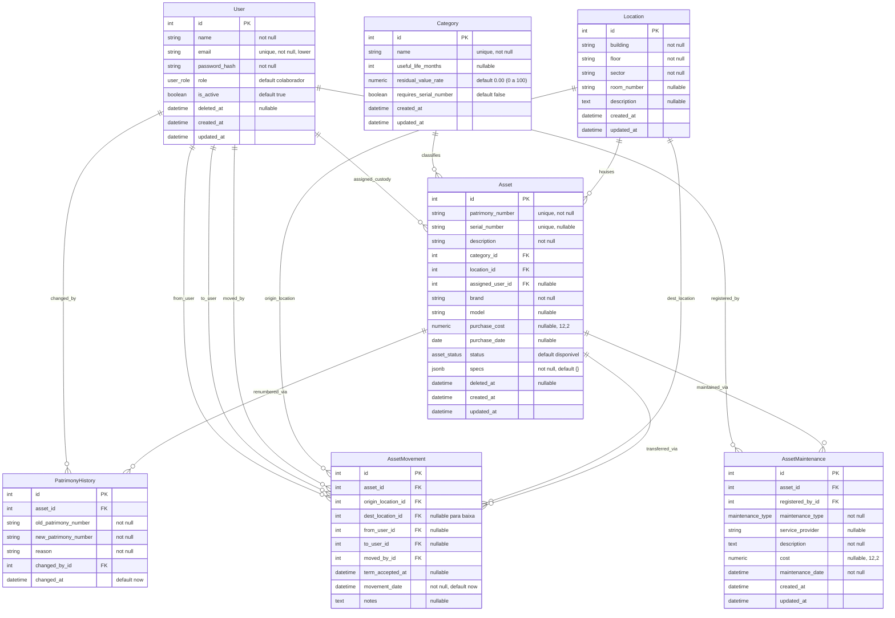
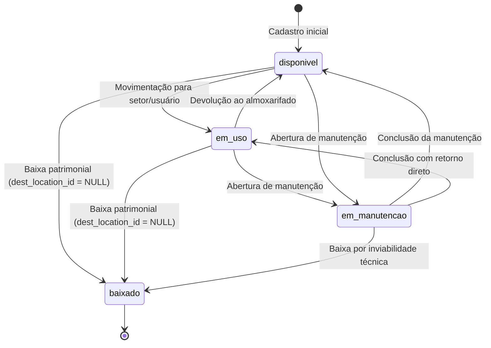

# Phase 1 Data Model: Gerenciamento de Patrimônio

**Feature**: `001-gerenciamento-patrimonio`  
**Date**: 2026-10-22  
**Status**: Completed  

---

## 1. Enums do Domínio

### 1.1. `user_role`
Representa os níveis de privilégio de acesso ao SisPatrimonio:
- `administrador`: Gestão completa de usuários, categorias, configurações contábeis e todas as operações patrimoniais.
- `tecnico`: Cadastro, edição, movimentação, renumeração e lançamento de manutenções em ativos.
- `colaborador`: Consulta de ativos sob sua custódia e confirmação de aceite de termos de responsabilidade.

### 1.2. `asset_status`
Ciclo de vida operacional do ativo patrimonial:
- `disponivel`: Bem em estoque/almoxarifado pronto para alocação.
- `em_uso`: Ativo alocado em um setor/sala sob custódia de um colaborador.
- `em_manutencao`: Ativo em intervenção técnica preventiva ou corretiva.
- `baixado`: Ativo desincorporado, alienado ou descartado (fora de operação).

### 1.3. `maintenance_type`
Classificação da intervenção de manutenção:
- `preventiva`: Revisão periódica planejada.
- `corretiva`: Reparo de avaria ou restauração de funcionalidade com falha.

---

## 2. Entidades & Esquema Relacional

---

## 3. Regras de Negócio & Validações de Domínio

### 3.1. Validações da Entidade `Asset`
1. **Unicidade de Patrimônio**: `patrimony_number` é único e permanente no sistema.
2. **Número de Série Condicional**: Se a `Category` associada tiver `requires_serial_number == true`, a criação ou edição do `Asset` DEVE rejeitar payloads sem `serial_number`. Se fornecido, `serial_number` deve ser único.
3. **Custo de Aquisição**: `purchase_cost` deve ser `>= 0.00`.
4. **Alocação de Custodiante**: Se `assigned_user_id` for informado, o usuário deve possuir `is_active == true` e `deleted_at == null`.

### 3.2. Validações da Entidade `Location`
1. **Unicidade Física Composta**: A combinação `(building, floor, sector, room_number)` é única.

### 3.3. Validações da Entidade `Category`
1. **Taxa de Valor Residual**: `residual_value_rate` deve estar estritamente entre `0.00` e `100.00`.
2. **Vida Útil**: `useful_life_months` deve ser um inteiro positivo (`>= 1`).

### 3.4. Transições de Estado de Ativos

### 3.5. Transação Atômica de Renumeração (`patrimony_history`)
Ao atualizar `assets.patrimony_number`:
1. Verifica se o novo patrimônio já está em uso por outro ativo.
2. Registra linha imutável em `patrimony_history` com `asset_id`, `old_patrimony_number`, `new_patrimony_number`, `reason`, `changed_by_id`, `changed_at`.
3. Atualiza `assets.patrimony_number` e `updated_at`.
4. Executa `commit` atômico conjunto na mesma transação.
