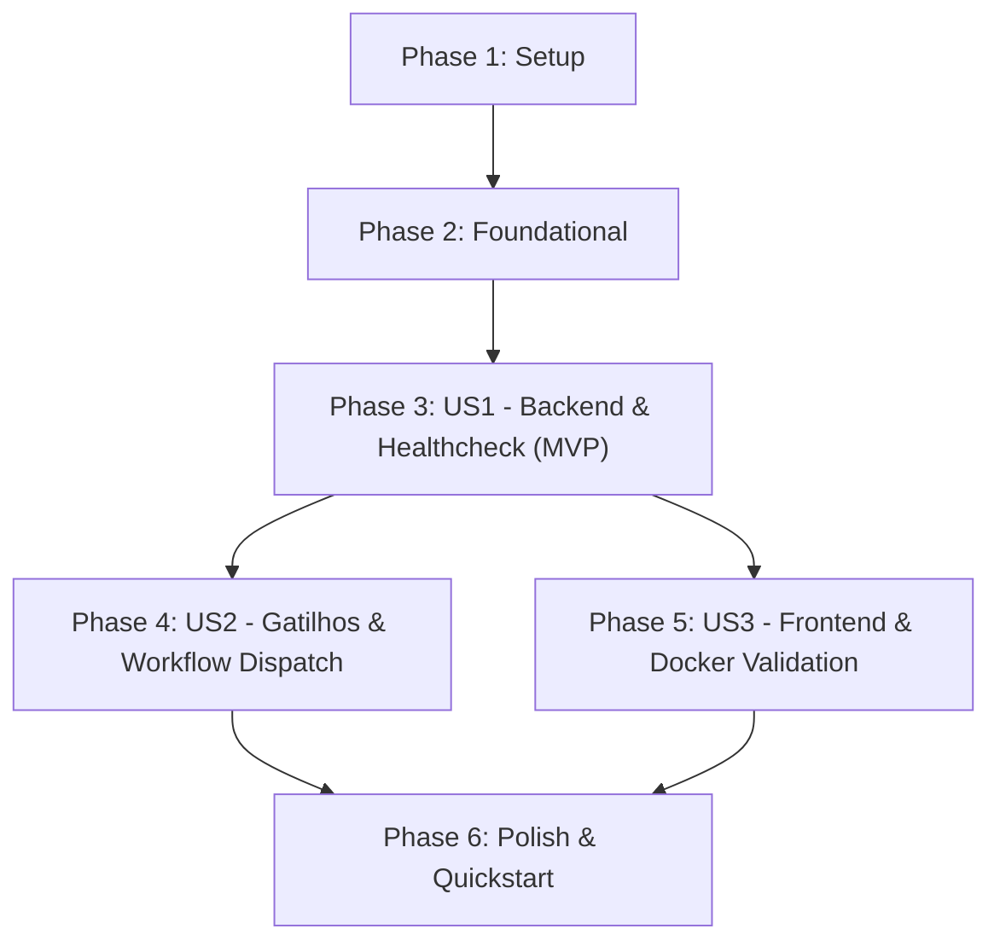

# Tasks: Correção e Estabilização do Pipeline de Integração Contínua (CI)

**Input**: Design documents from [`specs/002-fix-ci-pipeline/`](plan.md)  
**Prerequisites**: [`plan.md`](plan.md), [`spec.md`](spec.md), [`research.md`](research.md), [`data-model.md`](data-model.md), [`contracts/ci-workflow-contract.md`](contracts/ci-workflow-contract.md), [`quickstart.md`](quickstart.md)  
**Governance**: [`.specify/memory/constitution.md`](../../.specify/memory/constitution.md)

## Organization & Rules

- **Format**: `- [ ] [TaskID] [P?] [Story?] Description with file path`
- **[P]**: Tarefas que podem ser executadas em paralelo (arquivos distintos, sem dependência de tarefas incompletas).
- **[Story]**: Rótulo da User Story correspondente (`[US1]`, `[US2]`, `[US3]`) derivado de [`spec.md`](spec.md).
- Fases de Setup, Foundational e Polish não possuem rótulo de User Story.

---

## Phase 1: Setup (Shared Infrastructure)

**Purpose**: Verificação das ferramentas de análise e dependências de ambiente

- [X] T001 Inspecionar e validar configurações de ambiente de teste em `.github/workflows/ci.yml` e `pyproject.toml`
- [X] T002 [P] Validar ferramentas de análise estática e formatação do repositório em `pyproject.toml` e `frontend/package.json`

---

## Phase 2: Foundational (Blocking Prerequisites)

**Purpose**: Auditoria dos pontos de falha que bloqueiam a execução confiável do pipeline

**⚠️ CRITICAL**: A auditoria das causas-raiz deve estar consolidada antes da aplicação dos ajustes nas User Stories

- [X] T003 Auditar discrepâncias de formatação e regras do Ruff apontadas em `src/domain/schemas.py`, `src/infrastructure/repositories.py`, `src/infrastructure/seed.py`, `src/use_cases/authenticate_user.py` e `src/use_cases/import_spreadsheet_use_cases.py`
- [X] T004 [P] Auditar a declaração do serviço PostgreSQL e parâmetros de healthcheck em `.github/workflows/ci.yml`

**Checkpoint**: Pré-requisitos analisados - implementação das User Stories pode iniciar

---

## Phase 3: User Story 1 - Validação Automatizada e Confiável da Camada Backend (Priority: P1) 🎯 MVP

**Goal**: Eliminar as falhas espúrias no job `backend-tests`, corrigindo a autenticação do healthcheck do PostgreSQL e aplicando a formatação padrão com o Ruff em `src/infrastructure/seed.py`, preservando 100% de cobertura nos testes.

**Independent Test**: Executar `ruff format --check src/` sem erros e verificar que o container `postgres:16-alpine` responde ao healthcheck autenticado (`pg_isready -U postgres -d test_patrimonio_db`), permitindo a aplicação das migrações do Alembic e execução do Pytest com 100% de cobertura de código.

### Implementation for User Story 1

- [X] T005 [US1] Formatar os arquivos Python em `src/domain/schemas.py`, `src/infrastructure/repositories.py`, `src/infrastructure/seed.py`, `src/use_cases/authenticate_user.py` e `src/use_cases/import_spreadsheet_use_cases.py` em conformidade com o formatador Ruff
- [X] T006 [US1] Atualizar o comando de healthcheck do container de serviço PostgreSQL para `pg_isready -U postgres -d test_patrimonio_db` em `.github/workflows/ci.yml`
- [X] T007 [P] [US1] Validar localmente a formatação e linter com `ruff check src/` e `ruff format --check src/` em `src/`
- [X] T008 [US1] Validar a execução e reversibilidade das migrações do banco (`upgrade head` e `downgrade base`) em `alembic/versions/e5f6a7b8c9d0_purge_legacy_database_tables.py`
- [X] T009 [US1] Validar a suíte de testes de backend e integridade referencial de importação em `src/use_cases/import_spreadsheet_use_cases.py`, `src/api/import_routes.py`, `tests/test_import_use_cases.py` e `tests/`, assegurando o gate inegociável de 100% de cobertura

**Checkpoint**: User Story 1 (MVP) concluída e testável de forma independente. O backend agora executa com sucesso sem falhas de container ou formatação.

---

## Phase 4: User Story 2 - Disparo Abrangente e Notificação Rápida de Falhas (Priority: P2)

**Goal**: Habilitar a execução manual sob demanda (`workflow_dispatch`) e assegurar gatilhos consistentes para pull requests e branches principais.

**Independent Test**: Verificar se o GitHub Actions permite disparar o workflow sob demanda em qualquer branch via `gh workflow run "CI Pipeline"` e se eventos de pull request acionam todos os jobs.

### Implementation for User Story 2

- [X] T010 [US2] Adicionar o gatilho `workflow_dispatch:` na seção `on:` de `.github/workflows/ci.yml`
- [X] T011 [US2] Validar e harmonizar os gatilhos de `push` e `pull_request` para branches `main`, `develop`, `master` em `.github/workflows/ci.yml`

**Checkpoint**: User Stories 1 e 2 plenamente operacionais. O pipeline pode ser acionado sob demanda e responde aos eventos de pull request.

---

## Phase 5: User Story 3 - Validação Paralela de Frontend e Empacotamento de Imagens (Priority: P3)

**Goal**: Assegurar a continuidade e estabilidade dos jobs paralelos `frontend-tests` e `docker-build-check`.

**Independent Test**: Confirmar a execução paralela e aprovação de `frontend-tests` (TypeScript, linter, testes Vitest, build Vite) e `docker-build-check` (build multi-stage das imagens Docker de backend e frontend).

### Implementation for User Story 3

- [X] T012 [P] [US3] Validar dependências, checagem de tipos estáticos e testes do frontend em `frontend/package.json` e `frontend/src/`
- [X] T013 [P] [US3] Validar targets multi-stage de produção no backend e frontend em `Dockerfile` e `frontend/Dockerfile`

**Checkpoint**: Todos os três jobs paralelos do pipeline operam de forma confiável e independente.

---

## Phase 6: Polish & Cross-Cutting Concerns

**Purpose**: Verificação ponta a ponta e documentação consolidada

- [X] T014 Executar a validação completa do roteiro de testes em `specs/002-fix-ci-pipeline/quickstart.md`
- [X] T015 [P] Atualizar documentação e histórico de correções em `specs/002-fix-ci-pipeline/README_CORRECOES.md`

---

## Dependencies & Execution Order

### Phase Dependencies

- **Setup (Phase 1)**: Sem dependências - inicia imediatamente.
- **Foundational (Phase 2)**: Depende do Setup - audita causas-raiz antes das modificações.
- **User Story 1 (Phase 3)**: Depende da Fase Foundational - constitui o MVP essencial.
- **User Story 2 (Phase 4)**: Depende de US1 (ou pode executar concorrentemente se em arquivos isolados).
- **User Story 3 (Phase 5)**: Depende de Setup/Foundational - valida frontend e containers.
- **Polish (Phase 6)**: Depende da conclusão de todas as User Stories priorizadas.

### User Story Completion Flow



---

## Parallel Execution Examples

### Execução em Paralelo dentro da User Story 1:
```bash
# Executar a formatação do arquivo seed e a edição do workflow de CI:
Task: T005 Formatar o código de dados semente em src/infrastructure/seed.py
Task: T006 Atualizar o comando de healthcheck do PostgreSQL em .github/workflows/ci.yml
```

### Execução em Paralelo entre User Stories:
```bash
# Executar validação de frontend concorrentemente com ajustes de gatilhos:
Task: T010 [US2] Adicionar workflow_dispatch em .github/workflows/ci.yml
Task: T012 [US3] Validar dependências e tipos em frontend/package.json
```

---

## Implementation Strategy

### MVP First (User Story 1)
1. Completar Setup e Foundational (T001 a T004).
2. Implementar correções de US1 (T005 e T006).
3. Validar US1 localmente (T007 a T009).
4. **Checkpoint MVP**: O backend agora passa 100% no CI sem erros de inicialização de PostgreSQL nem falhas de formatação do Ruff.

### Entrega Incremental
1. Adicionar `workflow_dispatch` (US2 - T010 e T011).
2. Validar estabilidade contínua dos jobs de frontend e docker (US3 - T012 e T013).
3. Concluir com a validação final e documentação (Polish - T014 e T015).
