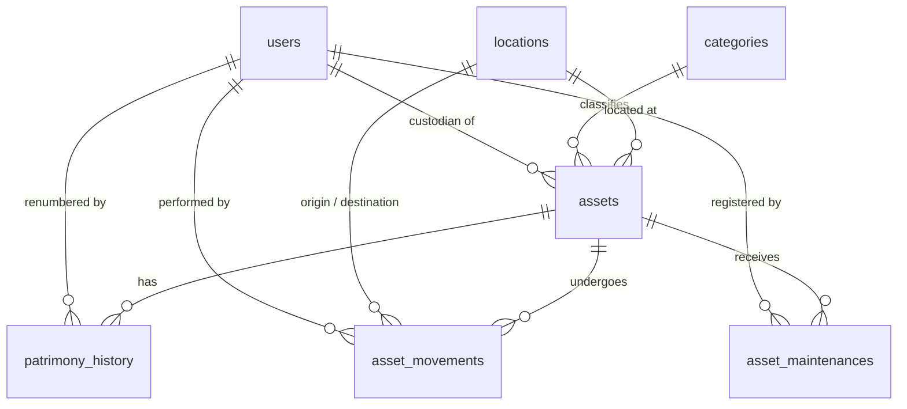

# Data Model: SisPatrimonio Strict DBML Alignment

**Feature**: `002-purge-legacy-database` | **Date**: 2026-10-28

The database strictly consists of **7 tables** and **3 enumerated types**. No extra tables, views, or obsolete columns exist.

---

## Enumerated Types

### 1. `user_role`
- Values: `'administrador'`, `'tecnico'`, `'colaborador'`

### 2. `asset_status`
- Values: `'disponivel'`, `'em_uso'`, `'em_manutencao'`, `'baixado'`

### 3. `maintenance_type`
- Values: `'preventiva'`, `'corretiva'`

---

## Tables and Fields

### 1. `users`
Represents application operators, custodians, and technical staff.
- `id`: integer [PK, autoincrement]
- `name`: varchar(255) [NOT NULL]
- `email`: varchar(255) [UNIQUE, NOT NULL]
- `password_hash`: varchar(255) [NOT NULL]
- `role`: user_role [NOT NULL, DEFAULT 'colaborador']
- `is_active`: boolean [NOT NULL, DEFAULT true]
- `deleted_at`: timestamptz [NULL]
- `created_at`: timestamptz [NOT NULL, DEFAULT now()]
- `updated_at`: timestamptz [NOT NULL, DEFAULT now()]

### 2. `locations`
Represents physical spaces in the institution.
- `id`: integer [PK, autoincrement]
- `building`: varchar(100) [NOT NULL]
- `floor`: varchar(50) [NOT NULL]
- `sector`: varchar(100) [NOT NULL]
- `room_number`: varchar(50) [NULL]
- `description`: text [NULL]
- `created_at`: timestamptz [NOT NULL, DEFAULT now()]
- `updated_at`: timestamptz [NOT NULL, DEFAULT now()]
- **Constraints / Indexes**:
  - `uq_locations_physical_space`: UNIQUE (building, floor, sector, room_number)

### 3. `categories`
Asset classification defining depreciation rates and identification rules.
- `id`: integer [PK, autoincrement]
- `name`: varchar(100) [UNIQUE, NOT NULL]
- `useful_life_months`: integer [NULL]
- `residual_value_rate`: numeric(5,2) [NOT NULL, DEFAULT 0.00]
- `requires_serial_number`: boolean [NOT NULL, DEFAULT false]
- `created_at`: timestamptz [NOT NULL, DEFAULT now()]
- `updated_at`: timestamptz [NOT NULL, DEFAULT now()]

### 4. `assets`
Core patrimonial goods.
- `id`: integer [PK, autoincrement]
- `patrimony_number`: varchar(100) [UNIQUE, NOT NULL]
- `serial_number`: varchar(100) [UNIQUE, NULL]
- `description`: varchar(255) [NOT NULL]
- `category_id`: integer [NOT NULL, REFERENCES categories(id) ON DELETE RESTRICT]
- `location_id`: integer [NOT NULL, REFERENCES locations(id) ON DELETE RESTRICT]
- `assigned_user_id`: integer [NULL, REFERENCES users(id) ON DELETE SET NULL]
- `brand`: varchar(100) [NOT NULL]
- `model`: varchar(100) [NULL]
- `purchase_cost`: numeric(12,2) [NULL]
- `purchase_date`: date [NULL]
- `status`: asset_status [NOT NULL, DEFAULT 'disponivel']
- `specs`: jsonb [NOT NULL, DEFAULT '{}']
- `deleted_at`: timestamptz [NULL]
- `created_at`: timestamptz [NOT NULL, DEFAULT now()]
- `updated_at`: timestamptz [NOT NULL, DEFAULT now()]

### 5. `patrimony_history`
Audit log of plate/number renumbering.
- `id`: integer [PK, autoincrement]
- `asset_id`: integer [NOT NULL, REFERENCES assets(id) ON DELETE CASCADE]
- `old_patrimony_number`: varchar(100) [NOT NULL]
- `new_patrimony_number`: varchar(100) [NOT NULL]
- `reason`: varchar(255) [NOT NULL]
- `changed_by_id`: integer [NOT NULL, REFERENCES users(id) ON DELETE RESTRICT]
- `changed_at`: timestamptz [NOT NULL, DEFAULT now()]

### 6. `asset_movements`
Physical location and custodian transfer log.
- `id`: integer [PK, autoincrement]
- `asset_id`: integer [NOT NULL, REFERENCES assets(id) ON DELETE CASCADE]
- `origin_location_id`: integer [NOT NULL, REFERENCES locations(id) ON DELETE RESTRICT]
- `dest_location_id`: integer [NULL, REFERENCES locations(id) ON DELETE RESTRICT]
- `from_user_id`: integer [NULL, REFERENCES users(id) ON DELETE SET NULL]
- `to_user_id`: integer [NULL, REFERENCES users(id) ON DELETE SET NULL]
- `moved_by_id`: integer [NOT NULL, REFERENCES users(id) ON DELETE RESTRICT]
- `term_accepted_at`: timestamptz [NULL]
- `movement_date`: timestamptz [NOT NULL, DEFAULT now()]
- `notes`: text [NULL]

### 7. `asset_maintenances`
Technical preventive and corrective maintenance logs.
- `id`: integer [PK, autoincrement]
- `asset_id`: integer [NOT NULL, REFERENCES assets(id) ON DELETE CASCADE]
- `registered_by_id`: integer [NOT NULL, REFERENCES users(id) ON DELETE RESTRICT]
- `maintenance_type`: maintenance_type [NOT NULL]
- `service_provider`: varchar(150) [NULL]
- `description`: text [NOT NULL]
- `cost`: numeric(12,2) [NULL]
- `maintenance_date`: timestamptz [NOT NULL]
- `created_at`: timestamptz [NOT NULL, DEFAULT now()]
- `updated_at`: timestamptz [NOT NULL, DEFAULT now()]

---

## Entity Relationship Diagram

