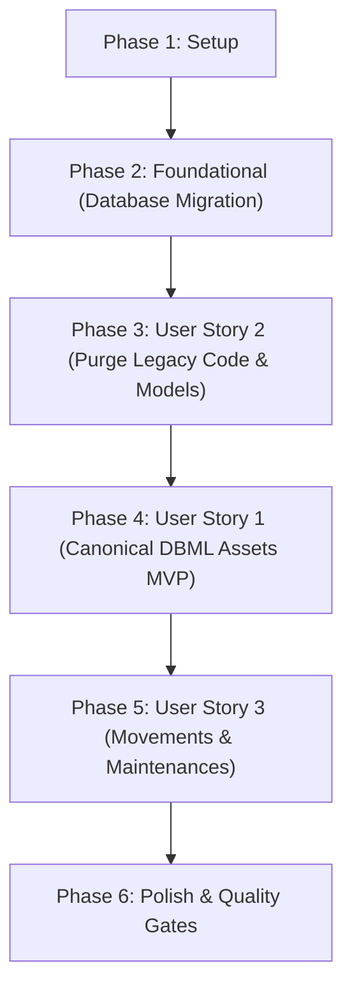

# Tasks: Purge Legacy Database and Strict DBML Alignment

**Input**: Design documents from `/specs/002-purge-legacy-database/`
- Spec: [`specs/002-purge-legacy-database/spec.md`](spec.md)
- Plan: [`specs/002-purge-legacy-database/plan.md`](plan.md)
- Data Model: [`specs/002-purge-legacy-database/data-model.md`](data-model.md)
- Contracts: [`specs/002-purge-legacy-database/contracts/api-contracts.md`](contracts/api-contracts.md)
- Quickstart: [`specs/002-purge-legacy-database/quickstart.md`](quickstart.md)
- Checklist: [`specs/002-purge-legacy-database/checklists/database-compliance.md`](checklists/database-compliance.md)

**Prerequisites**: plan.md, spec.md, data-model.md, contracts/api-contracts.md, quickstart.md

**Organization**: Tasks are grouped by user story to enable independent implementation, testing, and delivery.

## Format: `- [ ] [ID] [P?] [Story?] Description with file path`

- **[P]**: Can run in parallel (different files, no dependencies)
- **[Story]**: Which user story this task belongs to ([US1], [US2], [US3])
- Include exact file paths in all descriptions

---

## Phase 1: Setup (Baseline & Environment)

**Purpose**: Validate current baseline and prepare migration environment

- [X] T001 Baseline verification of existing test suite passing with 100% coverage via `uv run pytest` in `tests/`
- [X] T002 [P] Inspect and ensure Alembic configuration in `alembic/env.py` imports only pure canonical metadata

---

## Phase 2: Foundational (Database Purge Migration)

**Purpose**: Database schema migration to drop all legacy tables and columns, leaving strictly the 7 DBML tables

**⚠️ CRITICAL**: Must complete before application models and code cleanup

- [X] T003 Create Alembic migration `alembic/versions/e5f6a7b8c9d0_purge_legacy_database_tables.py` dropping tables `equipment_maintenances`, `equipment_movements`, `equipments`, `equipment_statuses`, `maintenance_types`, `sectors`, `equipment_types`, `login_attempts` in foreign key order and dropping column `users.hashed_password`
- [X] T004 [P] Verify and update standalone DDL schema script in `database/schema.sql` to strictly reflect the 7 DBML tables (`users`, `locations`, `categories`, `assets`, `patrimony_history`, `asset_movements`, `asset_maintenances`) and 3 enums (`user_role`, `asset_status`, `maintenance_type`)
- [X] T005 [P] Update database seed population SQL script in `database/populate.sql` to populate exclusively the 7 DBML tables without any legacy table inserts

**Checkpoint**: Database layer has zero legacy tables and strictly matches DBML specification.

---

## Phase 3: User Story 2 - Descomissionamento Total de Estruturas e Tabelas Fora do DBML (Priority: P1)

**Goal**: Purge all obsolete ORM models, Pydantic schemas, repositories, and legacy endpoints so the codebase has no remaining references to deleted tables.

**Independent Test**: Verify via inspection and AST/import checks that no legacy model classes exist in `src/domain/models.py` and that the application starts cleanly without referencing deleted tables.

### Implementation for User Story 2

- [X] T006 [US2] Remove legacy ORM model classes (`Equipment`, `EquipmentType`, `Sector`, `EquipmentStatus`, `MaintenanceType`, `EquipmentMovement`, `EquipmentMaintenance`, `LoginAttempt`, `IPAddressType`, `MACAddressType`) and remove `hashed_password` synonym from `User` in `src/domain/models.py`
- [X] T007 [P] [US2] Remove obsolete equipment and catalog Pydantic schemas (`EquipmentCreate`, `EquipmentUpdate`, `EquipmentResponse`, `EquipmentListResponse`, `CatalogItemCreate`, `SectorCreate`, `TagCreate`, etc.) from `src/domain/schemas.py`
- [X] T008 [P] [US2] Remove obsolete legacy query methods (`EquipmentRepository`, `CatalogRepository`, `TagRepository`, `LoginAttemptRepository`) from `src/infrastructure/repositories.py`
- [X] T009 [US2] Delete obsolete API route files `src/api/equipment_routes.py` and `src/api/catalog_routes.py` and remove their router includes from `src/main.py`
- [X] T010 [US2] Delete obsolete use case file `src/use_cases/equipment_use_cases.py`
- [X] T011 [P] [US2] Remove obsolete test files (`tests/test_equipment_api.py`, `tests/test_equipment_models.py`, `tests/test_tags_and_coverage.py`) that test deleted legacy tables in `tests/`

**Checkpoint**: Codebase is fully purified with zero legacy models, schemas, or routes.

---

## Phase 4: User Story 1 - Gestão Patrimonial Estrita pelo Modelo Canônico DBML (Priority: P1) 🎯 MVP

**Goal**: Ensure all asset lifecycle operations (registration, retrieval, update, renumbering, import, export, metrics) run exclusively through canonical DBML entities (`assets`, `locations`, `categories`, `users`).

**Independent Test**: Execute full CRUD cycle on assets, categories, and locations using canonical endpoints `/api/v1/assets`, `/api/v1/categories`, `/api/v1/locations`, and verify data persistence in PostgreSQL.

### Implementation for User Story 1

- [X] T012 [P] [US1] Update authentication use case and security helper to use strictly `password_hash` in `src/use_cases/authenticate_user.py` and `src/core/security.py`
- [X] T013 [P] [US1] Verify canonical Asset, Category, and Location repository methods in `src/infrastructure/repositories.py`
- [X] T014 [US1] Update canonical asset use cases in `src/use_cases/asset_use_cases.py`, `src/use_cases/category_use_cases.py`, and `src/use_cases/location_use_cases.py` to ensure complete coverage of DBML fields (`patrimony_number`, `serial_number`, `description`, `brand`, `model`, `purchase_cost`, `purchase_date`, `status`, `specs`)
- [X] T015 [US1] Update canonical asset routes in `src/api/asset_routes.py`, `src/api/category_routes.py`, and `src/api/location_routes.py` per contracts in `specs/002-purge-legacy-database/contracts/api-contracts.md`
- [X] T016 [P] [US1] Refactor spreadsheet parser and exporter to read and write canonical `Asset`, `Category`, and `Location` data in `src/infrastructure/spreadsheet_parser.py` and `src/infrastructure/spreadsheet_exporter.py`
- [X] T017 [US1] Refactor spreadsheet import use case and endpoints to insert into canonical DBML tables in `src/use_cases/import_spreadsheet_use_cases.py` and `src/api/import_routes.py`
- [X] T018 [US1] Refactor dashboard metrics use case and routes to compute inventory totals from `Asset`, `Category`, `Location` in `src/use_cases/get_dashboard_metrics.py` and `src/api/dashboard_routes.py`
- [X] T019 [P] [US1] Refactor database seed service to insert initial dataset into canonical DBML tables in `src/infrastructure/seed.py`
- [X] T020 [P] [US1] Update CLI commands `create-db` and `seed-db` to operate on canonical models in `src/cli.py`
- [X] T021 [US1] Update and expand unit and API tests for canonical asset lifecycle in `tests/test_asset_api.py`, `tests/test_asset_models.py`, `tests/test_asset_schemas.py`, and `tests/test_api.py`

**Checkpoint**: Core patrimony management is fully functional on canonical DBML entities with all tests passing.

---

## Phase 5: User Story 3 - Integridade Referencial e Proteção de Dados Órfãos (Priority: P2)

**Goal**: Ensure physical transfers, custodian changes, and maintenance records enforce strict foreign key integrity, cascade deletions, and prevent orphaned records.

**Independent Test**: Register movement and maintenance records, test rejection of invalid locations/users, and verify that asset deletion cascades only to its own histories without affecting parent locations or users.

### Implementation for User Story 3

- [X] T022 [P] [US3] Verify and update movement use cases enforcing valid `origin_location_id`, `dest_location_id`, `from_user_id`, `to_user_id`, and `moved_by_id` in `src/use_cases/movement_use_cases.py`
- [X] T023 [P] [US3] Verify and update maintenance use cases enforcing valid `asset_id`, `registered_by_id`, `maintenance_type` ('preventiva' or 'corretiva'), `cost`, and `maintenance_date` in `src/use_cases/maintenance_use_cases.py`
- [X] T024 [US3] Verify and update movement and maintenance API routes in `src/api/movement_routes.py` per contracts in `specs/002-purge-legacy-database/contracts/api-contracts.md`
- [X] T025 [P] [US3] Add tests for movement and maintenance lifecycle, referential constraints, and cascade behavior in `tests/test_movement_routes.py` and `tests/test_asset_models.py`

**Checkpoint**: Movements and maintenances strictly adhere to DBML constraints with complete referential integrity.

---

## Phase 6: Polish & Cross-Cutting Concerns

**Purpose**: Validation, quality gates, and final cleanups

- [X] T026 [P] Update API metadata, title, and OpenAPI tags in `src/main.py`
- [X] T027 Execute database migration and table catalog validation steps in `specs/002-purge-legacy-database/quickstart.md`
- [X] T028 Run full test suite with `--cov=src --cov-branch --cov-report=term-missing` and verify 100% line and branch test coverage across all active modules in `tests/`
- [X] T029 [P] Run code formatter and linter via `uv run ruff check src tests` to ensure zero styling or linting violations

---

## Dependencies & Execution Order

### Phase Dependencies

### User Story Dependencies

- **US2 (Purge Legacy Structures)**: Depends on Phase 2 (migration created). Purges legacy models so that ORM reflects strictly DBML.
- **US1 (Canonical Assets MVP)**: Depends on US2 completion. Adapts all active endpoints and use cases to the purified models.
- **US3 (Movements & Maintenances)**: Depends on US1 completion. Integrates historical and movement tracking with canonical assets.

### Parallel Opportunities

- **Phase 2**: T004 (`schema.sql`) and T005 (`populate.sql`) can be updated in parallel with T003.
- **Phase 3**: T007 (`schemas.py`), T008 (`repositories.py`), and T011 (test files) can be worked in parallel once T006 is defined.
- **Phase 4**: T012 (`authenticate_user.py`), T013 (`repositories.py`), T016 (`spreadsheet_parser.py`), T019 (`seed.py`), and T020 (`cli.py`) can be executed in parallel.
- **Phase 5**: T022 (`movement_use_cases.py`), T023 (`maintenance_use_cases.py`), and T025 (`test_movement_routes.py`) can run in parallel.
- **Phase 6**: T026, T027, T028, and T029 can be executed sequentially or in parallel checks.

---

## Implementation Strategy

### MVP First (Phases 1, 2, 3, 4)
1. Run Phase 1 & 2 to create the Alembic migration that purges the 8 legacy tables.
2. Run Phase 3 to purge legacy models, schemas, routes, and tests.
3. Run Phase 4 to ensure canonical assets, categories, locations, and auth work cleanly.
4. **Validate MVP**: Run `uv run pytest` and test canonical asset endpoints.

### Incremental Delivery
1. Add Phase 5 for movements, renumbering, and maintenances.
2. Run Phase 6 to enforce 100% test coverage and ruff formatting.
3. Validate against `quickstart.md`.
